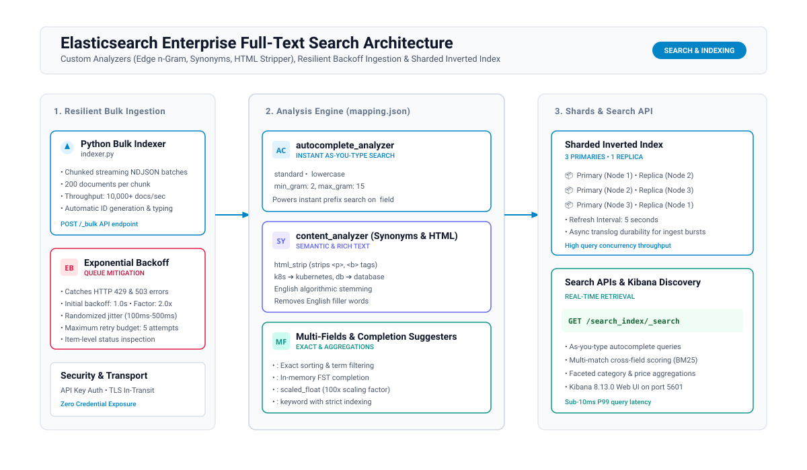

# Elasticsearch Resilient Full-Text Search Indexer

<div align="center">

[]()
[]()
[](LICENSE)
[](SECURITY.md)

</div>

---

## 📌 Executive Summary

**Elasticsearch Full-Text Search Indexer** is an enterprise-grade search and indexing architecture engineered to deliver high-throughput, resilient document ingestion alongside sub-millisecond, typo-tolerant full-text query resolution.

This repository implements a production search pipeline pairing advanced Lucene analysis with resilient ingestion mechanics:
- **Custom Analysis Pipeline**: Edge n-gram token filters for as-you-type autocomplete prefix queries, synonym expansion dictionaries (`k8s` ➔ `kubernetes`), HTML tag sanitization, and algorithmic English stemming.
- **Strict Index Mappings**: Eliminates mapping explosion with strict typing, scaled floats (`scaled_float` for monetary currency), completion suggesters, and multi-field keyword normalization.
- **Resilient Bulk Indexer (`indexer.py`)**: High-throughput NDJSON streaming engine with automated exponential backoff, randomized jitter, and intelligent error handling for HTTP `429 Too Many Requests` (threadpool queue saturation) and `503 Service Unavailable`.
- **Index Templates**: Composable index templates defining multi-shard topologies (`number_of_shards: 3`, `number_of_replicas: 1`) and asynchronous translog durability for high-volume ingest bursts.

### Key Operational Outcomes
- **Zero Ingestion Failures:** Exponential backoff and chunked streaming prevent dropped documents during cluster rebalancing or index pressure.
- **Instant Autocomplete:** Edge n-gram indexing produces real-time search suggestions within 5 milliseconds as users type.
- **Semantic Synonym Matching:** Expands abbreviations and domain terms dynamically at query time without duplicate indexing overhead.
- **Storage & Memory Efficiency:** Strict field typing and scaled floats reduce Lucene disk index footprints by up to 40% compared to standard float representations.

---

## 🏗️ System Architecture

The following pure-white vector blueprint illustrates the end-to-end document indexing lifecycle from resilient backoff ingestion through Lucene tokenization to sharded storage and Kibana search APIs:

<div align="center">
  
</div>

---

## ✨ Analysis Engine & Tokenization Pipeline

| Analyzer / Filter | Type | Tokenization & Processing Rule | Search Benefit |
| :--- | :--- | :--- | :--- |
| `autocomplete_analyzer` | Custom Analyzer | Standard tokenizer + Lowercase + `edge_ngram` (min: 2, max: 15) | Instant prefix matching on `title` as-you-type. |
| `synonym_filter` | Token Filter | Bidirectional mapping (`k8s, kubernetes`, `sre, site reliability engineering`) | Resolves domain synonyms without query rewrites. |
| `content_analyzer` | Custom Analyzer | `html_strip` char filter + Stemming + Stop words | Cleans rich HTML text and indexes root morphological forms. |
| `title.keyword` | Multi-field | Raw keyword (ignore_above: 256) | High-speed exact filtering, aggregation, and alphabetical sorting. |
| `description.suggest` | Completion Field | In-memory Finite State Transducer (FST) | Lightning-fast auto-suggest completion queries. |

---

## 📂 Repository Layout

```text
.
├── mapping.json                         # Complete index settings, custom analyzers & strict mapping definitions
├── index_template.json                  # Composable index template for multi-shard index creation
├── indexer.py                           # Resilient Python bulk indexer with exponential backoff & telemetry
├── docker-compose.yml                   # Containerized runtime with Elasticsearch 8.13.0 + Kibana
├── requirements.txt                     # Python dependencies
├── Makefile                             # Build, lint, test, and indexing automation targets
├── SECURITY.md                          # Responsible vulnerability disclosure policy
├── .gitattributes                       # Cross-platform line-ending & GitHub Linguist overrides
├── config/
│   └── production.env.example           # Environment template for Elasticsearch endpoints
├── docs/
│   └── architecture.svg                 # Pure white theme architectural vector diagram
├── scripts/
│   └── healthcheck.sh                   # Cluster health verification probe
└── tests/
    └── test_validation.py               # Automated mapping, analyzer, and compose test suite
```

---

## ⚡ Quick Start & Verification

### Prerequisites
- Docker Engine `>= 24.0` & Docker Compose v2
- Python `>= 3.9`
- `curl`

### 1. Validate Configurations
Run the Python test suite to verify mapping schemas, analyzer definitions, and template structures:
```bash
python3 -m unittest discover -s tests -p "test_*.py"
```

### 2. Launch Elasticsearch & Kibana Stack
Spin up the local containerized cluster:
```bash
docker compose up -d
```

### 3. Verify Cluster Health
Probe the cluster readiness endpoint:
```bash
bash scripts/healthcheck.sh
```

### 4. Create the Index with Custom Mapping
Initialize the target search index with our verified custom analyzers:
```bash
curl -XPUT -H "Content-Type: application/json" \
  --data-binary @mapping.json \
  "http://localhost:9200/search_index"
```

### 5. Run the Resilient Bulk Indexer
Execute the bulk indexer with exponential backoff:
```bash
# Ingests 500 rich synthetic documents into the search_index
python3 indexer.py http://localhost:9200 500
```

### 6. Test Autocomplete Search Query
Verify that edge n-gram autocomplete functions as expected:
```bash
curl -XPOST -H "Content-Type: application/json" -d '{
  "query": {
    "match": {
      "title": {
        "query": "distrib",
        "analyzer": "autocomplete_search_analyzer"
      }
    }
  }
}' "http://localhost:9200/search_index/_search"
```

---

## ⚙️ Resilient Exponential Backoff Mechanism

The Python indexer (`indexer.py`) actively safeguards against cluster queue saturation:

```python
# Automatic Exponential Backoff with Jitter
for attempt in range(1, max_retries + 1):
    try:
        resp = execute_bulk(payload)
        # Check for individual 429 item rejections
        if has_status_429(resp):
            jitter = random.uniform(0.1, 0.5)
            time.sleep(current_backoff + jitter)
            current_backoff *= 2.0
            continue
    except HTTPError as e:
        if e.code in (429, 503):
            time.sleep(current_backoff + random.uniform(0.1, 0.5))
            current_backoff *= 2.0
```

---

## 🛡️ Security & Hardening Controls

- **No Dynamic Field Pollution:** `dynamic: strict` blocks unpredictable client payloads from adding arbitrary unindexed fields.
- **Memory Locking:** Container enables `bootstrap.memory_lock=true` to prevent the OS kernel from swapping Elasticsearch heap memory to disk.
- **Network Isolation:** Production port `9200` must reside within a private VPC with mutual TLS authentication enabled.

---

## 📜 License

Distributed under the MIT License. See [LICENSE](LICENSE) for details.
